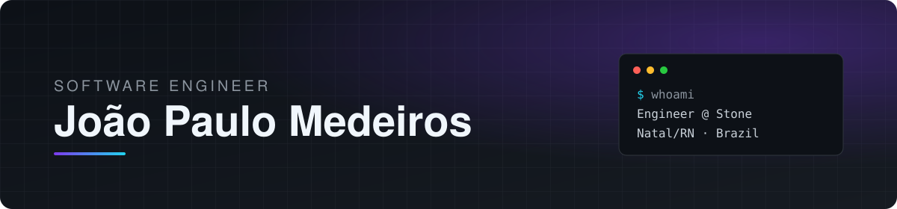

<picture>
  <source media="(prefers-color-scheme: dark)" srcset="./assets/header-dark.svg">
  <source media="(prefers-color-scheme: light)" srcset="./assets/header-light.svg">
  
</picture>

  
  
  

## Welcome 🖖

I'm a software engineer passionate about solving problems and helping people and businesses grow through technology.

I'm especially interested in:

- How things work under the hood;
- Data structures and algorithms;
- Clean code;
- Software architecture;
- Design patterns;
- Systems design.